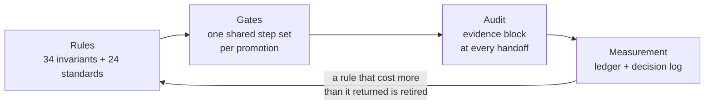
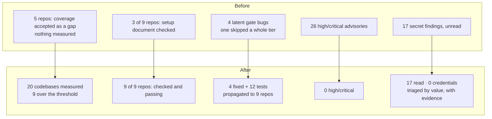
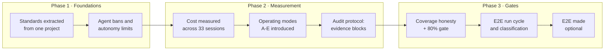

# docs — the record behind the rules

Why the rule set exists, how it is carried out, and what was measured. The rules themselves are in
[`CLAUDE.md`](../CLAUDE.md); the reason for each one is in [`decision-log.md`](decision-log.md).

| File | What it is |
|---|---|
| `decision-log.md` | The decision log: the rationale, measurements and retired text behind each numbered rule |
| `case-01-coverage-illusion.md` | Case: 95% reported coverage was 83% once generated code left the denominator; one codebase sat at ~14% behind an averaged number |
| `case-02-false-e2e-failures.md` | Case: 48 e2e failures that were an API rate limit, not product bugs — and why failures are classified before a re-run |
| `case-03-agent-cost-measurement.md` | Case: agent turns were 7.7% of cost, the orchestrator's cache reads 73% — measuring what agents actually cost |
| `case-04-the-audit-gap.md` | Case: nine roles, only one audited — the fix was mandatory evidence, not another agent |
| `benchmark-method.md` | How the measurements are produced and compared: what is and is not measured, the comparison rules, when a comparison is invalid, the reproduce commands |
| `coverage-gap.md` | Line coverage of this repository's own scripts against the 80% rule (#29): the measured numbers per script, the plan to close the gap, and why shell is not measured |
| `images/adyusuf-panels.webp` | The screenshot of the `adyusuf` pane, explained in [`hooks/README.md`](../hooks/README.md) |
| `measurement-log.md` | **Generated.** Aggregate statistics: prefix, per-role cost, how often each step ran (`scripts/step-stats.py`) |
| `project-nicknames.tsv` | **Local and git-ignored — holds real project folder keys, never commit it.** `<folder key><TAB><nickname>[<TAB><aliases>[<TAB>public]]`; the ledger and the reports show only the nickname, and `real-name-check.sh` searches the key and the aliases in every commit and message. A nickname may not contain a real project name |
| `measurement-daily-by-project.md` | **Generated, local, git-ignored.** Cost by day × project (nicknames), rewritten whenever the ledger is |
| `measurement-daily-by-role.md` | **Generated, local, git-ignored.** Cost by day × role (`main` = the conversation, the rest are agent roles) |
| `measurement-daily-by-kind.md` | **Generated, local, git-ignored.** Cost by day × kind (session / agent) |
| `measurement-daily-by-model.md` | **Generated, local, git-ignored.** Cost by day × model (a row is filed under the first model it used) |

`scripts/doc-check.py` fails when a file in this folder is missing from this table.

## Why this exists

**AI changed our lives — at least the lives of those of us who write software.**

The coding world will not be what it was. But the real question is not whether
the tools got better. It is this: in a world this vast, **how do we get the most
out of it without losing our way in it?**

My answer turned out to be boring, and it is this repository. Not a prompt
collection and not a framework — a rule set, a gate, and an audit protocol that
together do the things I always knew I should do and mostly could not:

- **Apply the SDLC / SSDLC practices we could never really do by hand.** A real
  coverage threshold per codebase. A secret scan on every push. Schema changes
  that stay backward compatible. A setup document a stranger can follow. E2E specs
  written with the feature. Not once a quarter — on every change.
- **Enforce them when a rule is not enough.** Some of it cannot be left to good
  intentions, so it is a gate with an exit code.
- **Keep the cost as low as it can be.** Agent teams get expensive fast, and
  most of the spend is not where it looks like it is.
- **Still scale to agent teams when I want them.** One file in the project
  switches between no agents and fourteen roles.
- **Run fast, and repeat as little as possible.** The heavy checks belong where
  code leaves for the outside world, not on every commit.
- **Shape the flows around SDLC roles** — analyst, architect, developer, qa,
  devops, security, data, e2e — rather than one agent doing everything.
- **Not let the role agents get away with mistakes.** The auditors assume the
  agents will be wrong, and assume the person supervising them will be too.

**Agentic coding, not just an AI coding tool** — that was a choice, and here is
the reasoning: a tool that answers questions cannot run a gate, and rules nobody
executes are documentation. The discipline only becomes real when something
*acts* on it per change. That said, the lowest mode (`A`) uses no agents at all,
so a plain coding assistant gets the same rules and the same gate; the agents
are how it scales, not how it works.

There is one thing behind all of it. An agent will happily apply every practice
on that list. **An agent will just as happily tell you that it did.** Everything
here is built for that gap: rules loaded before the work starts, gates that fail
loudly when a step did not run, and reports that are not accepted without
evidence.

Concretely, this is what that gap looks like. One project reported **95.0% test
coverage** — in CI, on a dashboard, undisputed. 85% of the denominator was EF
Core migrations: generated code that executes by itself whenever the tests run,
so it counts as covered without anyone ever asserting anything about it. The
honest figure was **83.0%**. And because that single number averaged four
codebases into one, it was also hiding a web client at **~14%**, where **107 of
136 files had no test touching them at all**. Nobody lied. The number was just
never asked the right question, and nothing was gating on the answer.
→ [Case 01](case-01-coverage-illusion.md)

**This is my live configuration, running as-is.** It is not a sample, a
write-up, or a tidied copy of something I keep privately: it is installed as a
Claude Code plugin from this repository's `prod` branch, so every session I open —
across every repository I work in, .NET and TypeScript, web and mobile — loads exactly the
files you are reading. When a rule here is wrong, it is wrong in my own working day first.
That is also why it changes so often: `prod` is the live branch, work happens on
`dev`, and promoting between them is a decision I have to make about my own
tooling.

## How it is carried out

The list above is the promise. This is the mechanism, in the same order.

**1. The practices become rules, not intentions.** 34 invariant rules load into
every session; 24 standards documents carry the detail. The agent does not get
to decide whether backward compatibility matters this time.

**2. Where a rule is not enough, a gate has an exit code.** A shared gate
(`scripts/gate-core.sh`) runs the same step set in every repository: formatter,
typecheck, build, unit tests, **coverage per codebase**, secret scan,
dependency CVE, SAST, backward-compatibility scan, the project documents check
(`SETUP.md`, `.env.example`, the secret inventory), guidance-file budget, and a
missing-e2e-spec check. The coverage threshold has no exception — a threshold
with an exception is a suggestion; only where it is measured is a setting.

**3. The cost is cut where the measurement says it is, not where it feels like
it is.** A subagent's tokens run roughly **4x** an orchestrator turn, and the
fixed prompt prefix is re-read on every single request — across the records here
that is **~11.1 billion tokens**. So the default runs the Opus roles on Sonnet
(`mode_model`), the wider modes are opt-in, and the audit protocol buys its rigour from the
*shape of the output* rather than from another agent: a role returns the
**command that produced its finding**, and re-running that command costs about
nothing.

**4. Scales up to agent teams when you want them.** Five operating modes, A to
E: no agents, three agents, nine roles, fourteen roles, fan-out. The mode is one
setting (session, project or default); choosing it *is* the approval, so there is no per-call
friction. Nothing else in the rule set changes with the mode.

The roles are **subagents**, not personas in a prompt. Each one is spawned by
the orchestrator with its own context window, its own tool allow-list and **its
own model** — and that is exactly why the bill behaves the way it does: a
subagent starts by reading the whole fixed prefix again, which is what makes its
tokens run about **4x** an orchestrator turn. So the model is assigned per role
by what the role actually has to do, not uniformly — the role table is in
[`modes/README.md`](../modes/README.md#the-14-roles).

⚠️ **The orchestrator has no `model:` field** — it is whatever `/model` selected
for the session, and it is the most expensive seat at the table, because its
context is re-read on every single request. Across the records in this
repository that is where the money went: **73%** of total spend was orchestrator
cache reads and **7.7%** was agent turns. Choosing cheaper agents while leaving
the orchestrator unexamined optimises the small half.

Every model here is a Claude model on purpose, and the reason is written down
rather than assumed: a subagent's `model:` field only accepts Anthropic models,
so a third-party comparison would answer a question this system cannot act on.

**5. Speed comes from where the checks sit, not from skipping them.** The shared gate is the
same step set at every target, and the configuration says before which push it
runs: by default not on `dev`, on `test` and `prod` (#25, #34). The formatter
runs once at the end of a task list, not per commit. E2E is optional and no gate
runs it (#33).

**6. The auditors assume the agents are wrong.** Every role whose output someone relies on
closes its report with an evidence block: the command it ran, each requested
item mapped to `file:line`, and what it could not verify. A report with no
evidence is not accepted. **What cannot be verified does not count as fine.** If
something is missing, the work goes *back* to the producer — it is not escalated
to the human as a question.

## Why it is measurement-driven

There are numbers behind these rules, not opinions. The decision log records how
each rule was discovered, which measurement produced it, and the text of rules
that have since been retired.

**Test coverage: what was reported vs. what was true**

| | | |
|---|---|---|
| Reported (raw) | `████████████████████` | **95.0%** |
| Honest (generated code excluded) | `█████████████████░░░` | **83.0%** |
| Same project, web codebase | `███░░░░░░░░░░░░░░░░░` | **~14%** |

EF Core migrations made up **85% of the denominator**. A single averaged number
hid the fact that 107 of 136 web files had no test touching them at all.

**Where the cost actually was**

| | | |
|---|---|---|
| Orchestrator cache reads | `███████████████░░░░░` | **73%** of total |
| Agent turns | `██░░░░░░░░░░░░░░░░░░` | **7.7%** of total |

Every agent call required approval, and the stated reason was cost. The
measurement showed the approval friction was guarding 7.7% of the bill while
slowing down every turn.

**Estimate vs. measurement for one agent role (`qa`, opus)**

| | | |
|---|---|---|
| Estimated (before) | `████████████████████` | $8 – $20 / turn |
| Measured (3 records, script) | `████░░░░░░░░░░░░░░░░` | **$4.10** / turn |

The estimate was 2–5x too high. The table was corrected; the estimate was not
defended.

## What it changed: before and after

One working day, nine repositories, one shared gate. Every number below was read
from the run that produced it — each codebase measured separately, never
averaged (#29).

**Coverage: from "accepted as a gap" to a number**

Five repositories listed `coverage` in their gate's accepted-gaps line. Their
gates printed GREEN while **nothing measured coverage at all**.

| | | |
|---|---|---|
| Codebases with a measured number, before | `░░░░░░░░░░░░░░░░░░░░` | **4** |
| After | `████████████████████` | **20** |
| Of those, at or above the 80% threshold | `█████████░░░░░░░░░░░` | **9** |

**The rule-#16 setup document (fail-closed)**

The gate's document step only fired when a stack sat at the repository root, so
it looked at three repositories and failed all three. Fixing the detection made
it look at nine.

| | | |
|---|---|---|
| Repositories the step examined, before | `██████░░░░░░░░░░░░░░` | **3 of 9** |
| Passing, before | `░░░░░░░░░░░░░░░░░░░░` | **0 of 3** |
| Examined, after | `████████████████████` | **9 of 9** |
| Passing, after | `████████████████████` | **9 of 9** |

**One web codebase, taken over the line**

| | | |
|---|---|---|
| Before — 141 tests | `██████████████░░░░░░` | **57.2%** |
| After — 221 tests | `████████████████████` | **81.4%** |

Eighty tests, and not one of them written for the percentage: a cancelled prompt
must not be read as a quota of zero, a failed delete must not navigate away as
if it had succeeded, a missing invitation token must render no form at all. The
repository's other codebase was already at 87.7%, so **both** are now above the
threshold and coverage stopped being its promotion blocker.

**Security findings, cleared**

| | | |
|---|---|---|
| High/critical dependency advisories | `████████████████████` **26** &rarr; `░░░░░░░░░░░░░░░░░░░░` **0** | four repositories |
| Secret-scan findings, read | `████████████████████` **17** | across two repositories |
| Of those, actual credentials | `░░░░░░░░░░░░░░░░░░░░` **0** | expired tokens, a model id, an interface name, a placeholder that says "enter a secret here" |

The scans had been failing for a while and nobody had read them. Reading them
mattered more than fixing them: a wrong escalation ("rotate the payment key")
was corrected by looking at the value the rule actually matched.

**Four bugs in the gate itself**

The gate is the thing that is supposed to catch everything else, so its own
defects are the most expensive kind. All four were found by reading failures
instead of trusting them, all four are covered by a test that fails without its
fix, and all four were propagated to nine repositories.

| Bug | What it did |
|---|---|
| `.slnx` and nested `.csproj` invisible | **Skipped an entire .NET backend** — 673 tests, a red build, two high-severity advisories — and printed GATE GREEN |
| `coverage` waivable via accepted gaps | Turned rule #29's "no exceptions" into a suggestion in five repositories |
| jest handed vitest's `--run` | Reported a passing suite of 10 tests as failing |
| Node detected only at the root | Skipped the setup-document check in any repository whose JS lives one level down |

⚠️ The first one is the one to remember. A gate that fails is annoying; a gate
that reports success for work it never looked at is worse than no gate, because
it ends an argument that should have continued.

**What turned out not to be broken**

Three failures that looked like product bugs were not: a frontend build and its
812 tests failing on an incomplete `node_modules`; a mobile tier reporting 0%
coverage because all 57 suites died on a missing module and no test ran at all;
an API-contract check failing without the environment variable its own
documentation prescribes. Each coverage script now checks its install first and names which
problem it is, because an environment problem that reads as a coverage problem
sends the next person hunting in the wrong file.

## Case studies

Each one ends with an **Honest limits** section: which numbers were measured,
which are estimates, and what is still open.

- [01 — The coverage illusion: how 95% turned out to be 83%](case-01-coverage-illusion.md)
- [02 — 48 false failures: mistaking an environment limit for a product bug](case-02-false-e2e-failures.md)
- [03 — Saving in the wrong place: measuring what agents actually cost](case-03-agent-cost-measurement.md)
- [04 — Nine roles, one of them audited](case-04-the-audit-gap.md)

## Progress

**Cost-table calibration** — how much of the cost model is measured rather than
estimated. This is the honest state, not a target:

| Role class | Status |
|---|---|
| `qa` (opus, auditing) | `████████████████████` measured — 3 records, ~$4.10/turn |
| Turn average across 33 sessions | `████████████████████` measured — ~$6.9/turn |
| `architect` / `developer` (writing roles) | `░░░░░░░░░░░░░░░░░░░░` estimated only |
| sonnet roles (`analyst`, `test-writer`, `devops`, …) | `░░░░░░░░░░░░░░░░░░░░` estimated only |
| `doc-writer` (haiku) | `░░░░░░░░░░░░░░░░░░░░` estimated only |
| Team modes (X / Y / Z) | `░░░░░░░░░░░░░░░░░░░░` never measured |

Thresholds have deliberately **not** been adjusted on this data: all three
calibration records came from the same kind of work, and a real end-to-end
feature turn has not been measured yet.

