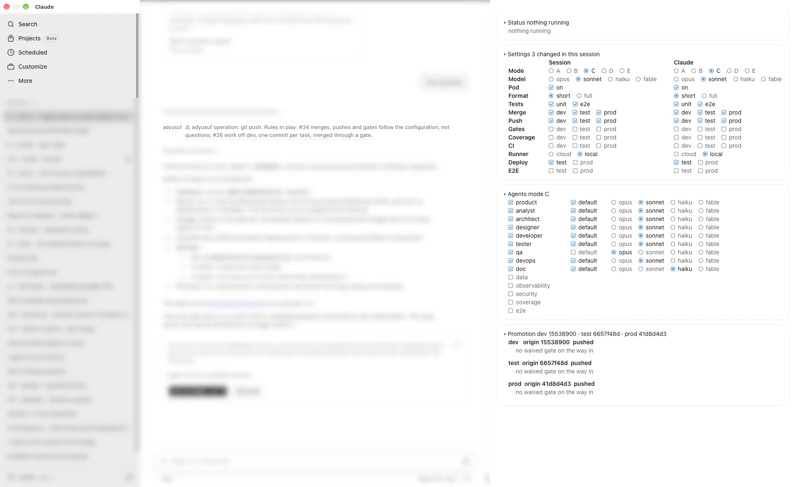

# hooks — what the plugin runs by itself, and the `adyusuf` pane

Installing someone else's plugin means running their code in your sessions, so this page lists everything the
plugin runs, reads, writes and sends.

## The hooks (`hooks.json`)

All of them run locally; none opens a network connection.

| When | Script | What it does |
|---|---|---|
| `SessionStart`, `SubagentStart` | `scripts/rules-context.py` (4 parts) | prints the plugin's `CLAUDE.md` into the session and every subagent, in parts of under 10,000 characters; reads only that file |
| `SessionStart` | `scripts/adyusuf_config.py context` | prints the effective settings (mode, models, merge/push/gate per target) and this session's id |
| `UserPromptSubmit`, `PostToolUse` (Agent, Bash) | `scripts/adyusuf_config.py notify` | when a setting changed since the session last looked, says so; keeps what it saw in `~/.claude/adyusuf-seen/<session id>` |
| `PreToolUse` (Bash) | `scripts/guard-destructive.sh` | refuses the never-do commands (forced push, push to `main`, `--no-verify`, `DROP`/`TRUNCATE`, `rm -rf` on `/` `~` `.` `*`); a push to `prod` is not judged here, it follows `push.prod` in the configuration |
| `PostToolUse` (Edit, Write), `Stop` | `scripts/md-hook.sh` | checks a touched `CLAUDE.md` against its size budget and for dropped rules, and the copied scripts for drift; warns only |

## The mod (`register.tsx`)

`hooks.json` also lists `register.tsx` under `modules`: a Claude Code mod that opens one pane, titled `adyusuf`, in the
right-hand rail of the desktop app when a session starts, and answers `/adyusuf:panels`. In a client that does not load
mods, the command prints the same settings as a table instead ([`commands/panels.md`](../commands/panels.md)).

What the mod runs and reads:

- `python3` to find the installed `adyusuf` plugin in `~/.claude/plugins/installed_plugins.json`, then
  `python3 scripts/adyusuf_config.py show/agents/schema/set` from that copy. A press in the pane runs `set --session <id>`:
  it changes this session only, never the saved defaults, unless the press is in the *System* column.
- read-only `git` (`for-each-ref`, `rev-parse`, `rev-list`, `log`) in the session's repository, for Promotion.
- `~/.claude/adyusuf-status/<session id>.json` (or `ADYUSUF_STATUS_DIR`) for Status: after every tool call, and every
  2 s when its modification time changed.
- Before a Bash or PowerShell command runs, it writes one `⚠ adyusuf operation: …` line into the chat when the command
  is one the rules govern (a push, a merge, a gate run), naming the rules in play.
- When a setting changes — in a box, through `/adyusuf:config` or by hand in a settings file — it writes
  `⚠ adyusuf setting changed (<layer>): <label> (<key>) old → new` into the chat, with the rules the setting steers.
- A press writes `~/.claude/adyusuf-session/<session id>.json` (this session's layer) or, in the *System* column,
  `~/.claude/adyusuf.json`.

It opens no network connection. The code is split so the drawing can be tested without the engine: `boxes.ts` (Settings,
Agents, Promotion), `controls.ts` (the shared icons, options and aligned lines), `status.ts` (Status), `choose.ts` (pure decisions), `notices.ts` (chat lines); `register.tsx` is the
engine glue. Tests: `deno test --sloppy-imports --import-map=scripts/ts-shim/import_map.json hooks/*.test.ts` (67 tests).

## The four boxes

The screenshot is of 01/11/2026. The left two-thirds are the app's session list and the conversation, blurred on purpose.
Each box folds by the arrow before its bold title (`▾` open, `▸` folded); Agents and Promotion start folded. The header
is the arrow and the title alone, with nothing beside it (the screenshot is older and still shows a summary there). The
boxes refresh after every turn, so a merge, a push or a `/adyusuf:config` change shows without
reopening them.

- **Status.** The status table of a long run: what runs now, what runs next, then item · state ·
  measured figure (with its signal) · waiting on. Claude writes it at every step with `scripts/adyusuf_status.py`, and so
  does a background gate or promotion ([`standards/00-working-method.md`](../standards/00-working-method.md) §10d).
- **Settings.** One row per setting: the label, then the **Session** column (what this
  session runs on) and the **System** column (the saved defaults in `~/.claude/adyusuf.json`, which every new session
  starts from). The System column folds by the arrow after its heading and starts folded, so the defaults are changed
  only when you open it: folded, **System** ▸ sits right beside *Session*; open, **System** ◂ sits over its column. (The
  screenshot is older: there the heading still reads *Claude*, with no arrow.)
  - *Mode* A–E (rule #27) and *Model\**, the model that replaces Opus in the roles marked `*` in Agents.
  - *Replies* (`short`, `normal`, `long`; default `short`): how much Claude writes in a reply
    ([`standards/00-working-method.md`](../standards/00-working-method.md) §5a).
  - *Pod* and *Format* are stored only; nothing acts on them yet.
  - *Tests* (`unit`, `e2e`): whether Claude writes unit tests and e2e specs.
  - *Merge*, *Push*, *Gates*, *Coverage* and *CI* (wait for CI after the push), per target. Rule #34 follows them
    instead of asking: when a piece of work is done Claude reads them afresh and merges and pushes at once
    ([`standards/13-pr-and-review.md`](../standards/13-pr-and-review.md) §8a). A gate set to no is recorded as
    `Gate-Waived` on the merge commit.
  - *Runner* (`cloud` = GitHub's runners, `local` = this machine's), *Deploy* (which environments a pushed update is
    deployed to) and *E2E* (run e2e before that deploy; rule #33).
- **Agents.** One line per role: the role's checkbox and name (pressing either switches the role on or off),
  then the model as one radio group (`opus`, `sonnet`, `haiku`, `fable`). The chosen radio is always the model the role
  runs on. Choosing the model its file and *Model\** give it writes `default`; choosing any other pins it. A `*` after
  the name marks a role whose file says opus, the roles *Model\** acts on. The name column has the same width as the
  Settings label column, so the radios start where the Settings options do; only roles that are on count for it. (The screenshot is older: it still shows a
  `default` checkbox between the name and the radios, since removed.) Five roles show a short name: `product`, `tester`, `doc`, `coverage`, `e2e`. The roles that are off belong to
  mode D; ticking one adds it to this session and marks it `(added)` at the end of its row. In mode A the box says it runs no agents.
- **Promotion.** One block per `dev`/`test`/`prod` branch: the commit
  `origin` holds, then `pushed` or `N not pushed`, and below it any `Gate-Waived` line on the commits waiting to come in
  from the stage before it; *no waived gate on the way in* means none.
- **Colours.** Red: the configuration could not be read. Orange: a settings file that could not be read, or a waived
  gate. Faded: waiting lines and options that are not chosen. Bold: titles and row labels. On the desktop a
  chosen option has a filled radio or checkbox icon; the terminal, which cannot draw SVG, shows it as `[C]`, `[dev]`.

## What runs only when you call it

- **`/adyusuf:*` skills and commands** tell Claude what to do; they run nothing on their own. `/adyusuf:board-plan`
  writes only the local plan file.
- **The gate** (`scripts/gate-core.sh`, run in your own project) runs your project's tools on your machine. Four of its
  steps reach the network: installing dependencies from the lockfile when `node_modules` is missing, the dependency
  audits (`npm audit`, `dotnet list package --vulnerable`), an optional `curl` to the `TEST_VERSION_URL` you set, and the
  `require-private-remote.sh` pre-push hook (`gh api`), if you install it.
- **`scripts/plugin-setup.py`** asks GitHub for the newest commit and runs the `claude plugin` commands; its log goes to
  `~/.claude-standards/logs/`.
- **`scripts/step-stats.py`** reads Claude Code's local transcripts (`~/.claude/projects`) and refuses to write a report
  that would leak a project name or path.

**No telemetry.** The plugin sends nothing anywhere by itself. Turn it off or remove it with `/plugin`.
